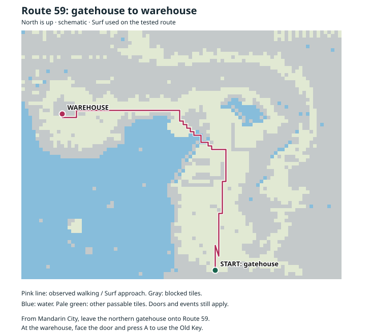
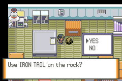
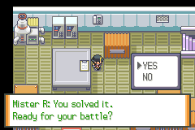
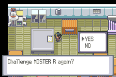
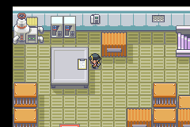
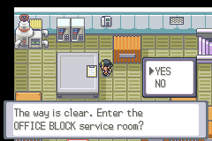
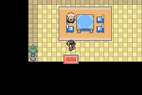
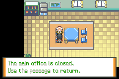

# Liquid Crystal continuation walkthrough

**Playable version: P002 — warehouse puzzle/battle plus Office Block service-room access.**
This guide covers the newly added path and the verified nearby approach. It is
not a complete walkthrough of the original Johto, Kanto or Orange Islands story.
Each released story slice extends this guide. P002 includes the complete P001
warehouse chapter below; its new service-room chapter begins at step7.

## Before you begin

- Use the P002 patched Liquid Crystal ROM and a copy of your own save. Keep an
  untouched backup of the original save.
- Reach the existing Mandarin City police-rescue event and obtain the **Old Key**.
  This guide begins after that rescue; it does not skip the earlier story gates.
- Bring a party member that knows **Iron Tail** or **Rock Smash**. Either solves
  the new puzzle. These instructions do not assume a particular TM/HM location.
- Bring Surf for Route 59's water sections. Heal and stock up before the battle:
  Mister R's six Pokémon are levels **94–96**.

The patch package README explains patching and the tested emulator adapter.
The supplied cartridge-converted ROM's stock-emulator/hardware compatibility is
not established by this walkthrough.

## 1. Reach the warehouse

1. After receiving the Old Key from the police rescue, leave the police building
   and return to **Mandarin City**.
2. Take the city's northern gatehouse toward **Route 59**. Walk through the
   gatehouse and leave by its north exit.
3. Follow Route 59 toward its **northwestern warehouse**. Cross the water with
   Surf when needed. This is the warehouse reached from outside the city, rather
   than the locked Office Block front door inside Mandarin City.
4. Face the warehouse door and press **A**. The existing game event uses your
   Old Key to unlock it. Enter through the door.

If the door stays locked, confirm that you received the Old Key from the police
rescue. Earlier police/city prerequisites still belong to the original game.

The diagram follows the approach observed during the linked replay. North is
up; start at the southern gatehouse and follow the pink route toward the warehouse.

## 2. Let Mister R finish his introduction

1. Enter the room and advance Mister R's dialogue with **A**.
2. He promises a battle after you solve his puzzle, then leaves the screen.
3. His disappearance is expected. The new puzzle remains available afterward.
4. Save through the game's **START → SAVE** menu before proceeding if desired.

Returning to a save where this introduction already happened does not require
replaying it.

## 3. Break the cracked rock

1. Walk north into the room. Find the **damaged sign** and the **cracked rock**
   immediately to its right.
2. Stand in the space **between the sign and the rock**.
3. Face **right**, toward the rock, and press **A**.
4. If your party knows Iron Tail, the game asks **“Use IRON TAIL on the rock?”**
   Otherwise it offers Rock Smash when that move is available.
5. Choose **YES**. The rock disappears and Mister R offers his battle.

If neither move is available, leave, obtain a suitable party member and return.
You do not lose progress. Choosing NO also leaves the puzzle available. Breaking
the rock does not consume an item or use up move PP. A fainted party member can
supply the move; an egg cannot.

## 4. Challenge Mister R

1. After the rock breaks, advance the dialogue.
2. Answer **YES** to **“Ready for your battle?”** to begin.
3. Answer **NO** if you want to heal or save first. Mister R disappears again,
   and you can call him back using the damaged sign.

The warehouse team is unchanged from P001:

| Pokémon | Level |
| --- | ---: |
| Crobat | 94 |
| Houndoom | 94 |
| Umbreon | 95 |
| Scizor | 95 |
| Gengar | 95 |
| Tyranitar | 96 |

Expect confusion, poison, recovery and strong attacks. Prepare a healthy late-game
team with varied attacking moves. Automated combat checks include a victory with
ordinary level100 stats, but they are not a recommended team or proof of fair
difficulty. Human balance testing is still pending.

## 5. Retry after declining or losing

1. If you lose, return to the warehouse after the blackout and recovery.
2. Go back to the space between the damaged sign and the former rock position.
3. Face **left**, toward the sign, and press **A**.
4. Advance through the original damaged clue. When asked **“Challenge MISTER R
   again?”**, choose **YES**.
5. The battle starts again. The rock stays broken, and you do not need another
   Iron Tail or Rock Smash check.

Only a victory completes the encounter. A loss does not complete it. Mister R is
an ordinary trainer battle, so Run is unavailable. If you quit during an attempt,
reloading restores your last in-game save; save after solving the rock if you
want that progress retained.

## 6. Finish and save

1. Win the battle and advance the ending dialogue.
2. Read the damaged sign again. After the old clue, P002 now offers entry into
   the Office Block service room. It will not start another Mister R battle.
   Choose **NO** if you want to save or leave first.
3. Use **START → SAVE**, choose **YES**, and confirm overwriting your working
   save if asked.
4. To leave, use the **same southern doorway** through which you entered. It
   returns to Route 59.

The warehouse battle is complete. You receive ordinary trainer prize money;
this encounter adds no badge, rank or quest item. Continue below for P002's new
Office service entrance. The city front door and Route60 remain unchanged.

## 7. Enter the Office Block service room

1. After winning, stand to the **right of the damaged warehouse sign**, face
   **left** and press **A**. Read through the original damaged clue.
2. The game asks **“The way is clear. Enter the OFFICE BLOCK service room?”**
3. Choose **YES** to travel through the service passage. Choose **NO** to stay
   in the warehouse. You can accept the offer later.
4. You arrive near the **southern door of a small furnished room**, beside a
   table and chairs. This is the Office Block service room.

The offer requires your warehouse victory. Solving only the rock, declining the
battle or losing does not unlock the new room. You do not need to teach another
move, obtain another key or repeat the battle after winning.

## 8. Explore, save and return

1. From your arrival point, walk **two tiles north**, face the attendant and
   press **A**. The attendant explains: **“The main office is closed. Use the
   passage to return.”**
2. You may save here through **START → SAVE → YES**. The new room and your
   completed warehouse progress survive a normal save and reload.
3. When ready to leave, walk back to the **southern door**, directly below the
   arrival position. Step **down** onto it.
4. You return to the warehouse's **original southern entrance**. Walk north
   into the room to reach the damaged sign again, or leave south for Route59.
5. The sign continues to offer entry to the service room. Repeat visits cost
   nothing and do not reset the rock or Mister R battle.

**This is the end of the added P002 story path.** The main Office floors remain
closed. This slice adds no further battle, item, badge or rank, and it does not
unlock the city front door or Route60. Use the service-room door to return;
the warehouse's other old stairs have not become new story paths.

**Before downgrading/removing P002:** leave the new service room, return to the
warehouse and save there. Keep an untouched save backup. A save left inside
the new room cannot be loaded by a P001-only or original ROM.

## Quick troubleshooting

| What you see | What to do |
| --- | --- |
| Mister R vanished after his introduction | Go to the cracked rock beside the damaged sign. |
| The rock asks for a move | Put a non-egg Iron Tail or Rock Smash knower in your party and interact again. |
| The rock is gone but Mister R is absent | Face the damaged sign and press A; read the clue and accept the retry offer. |
| You lost the battle | Return to the warehouse and use the sign. The solved rock stays cleared. |
| The sign offers Office Block entry | Choose YES for the service room, or NO to stay in the warehouse. |
| The attendant says the main office is closed | You reached the P002 endpoint. Leave through the southern door to return. |
| The Office entry offer never appears | Win Mister R’s battle first. If already won, confirm you loaded the P002 ROM and correct working save. |
| Progress disappeared after restarting | Load the correct working save and use the in-game Save menu after each completed stage. |

The supplied `P001-ready-fixture.sav` or `P002-office-fixture.sav`, if present in the research workspace, are
artificial QA saves with generated, boosted teams. They are not needed for this
walkthrough and should not replace your personal save.
