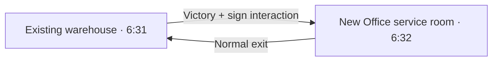

# P002 proposal: Office Block service entrance

**Ready for review; no P002 ROM has been built.** P001 remains the tested,
approved build. This proposal adds one small service room after the warehouse
battle, with a working return route. It does not yet add the Office quest,
upper floors, another battle, rank, reward or Route 60.

## Player experience

After defeating Mister R, read the damaged warehouse sign. The original clue
still appears, followed by “The way is clear. Enter the OFFICE BLOCK service
room?” Declining leaves the player in the warehouse; accepting enters the new
room. Its normal door returns to the warehouse. An attendant says, “The main
office is closed. Use the passage to return.” Entry remains repeatable.

The service room uses an existing 13×10 interior's art and geometry with its own
header/events. The original donor room 5:123 stays unchanged. The new placement,
links, prompt and attendant dialogue are **NEWLY_AUTHORED**, rather than recovered
developer content. The original police director's clue supports a secret Office
entrance outside the city, but does not establish this exact room or route.

## Evidence checked in this batch

**CONFIRMED_IN_ROM:** the police director's text at 904966 describes the locked
Office Block and an outside-city secret entrance. Mandarin's sign at 930D37
identifies that building; the locked-door text is at 904535. Route 59's sign at
A9C482 mentions Route 60 and Old Warehouse, but the inspected overworld bank
ends at slot111/Science Complex. No Route60 layout is established by that fact.

The existing city doorway has object17/flag5B6 at (54,17), object26/flag270 at
(54,16), a BG script and a legacy warp to 0:0. A controlled replay explicitly
hides those original objects on disposable RAM to inspect the underlying door.
It still displays the original locked text and blocks an upward step, both
before and after P001 completion. An earlier probe contacted the original
placeholder actor instead; that fixture error is retained and corrected.

**P002 leaves that entire front entrance and its story flags alone.** The new
service room returns to the warehouse, so it does not bypass original city
blockers or require repurposing their flags. Connecting upper floors/front-door
access is a later slice. These are bounded findings, not proof that all possible
Office content or computed map uses are absent.

The donor room's actual floor movement and appearance were checked in the
emulator. [Office access evidence](../extracted/runtime/office_access/office_access.json)
records six passing checks and the explicit state/object fixtures.

## Concrete storage and compatibility plan

Input is exact P001 ROM SHA256
`b2c3d4e3fb6f196de90bd9d88cbdcd850e429dce919034c48326d924ae413e92`.
Consume only P001's still-FF reserve B9F4E0–B9F700, plus two pointer hooks:
the warehouse sign's pointer at B9F3F0 and group6's bank pointer at 3526C0.
No ROM expansion, cartridge/engine change or new save field is proposed.

| Range | Capacity | Sizing preview |
| --- | ---: | ---: |
| B9F4E0–B9F580 scripts | 160 B | 95 B |
| B9F580–B9F600 text | 128 B | 109 B |
| B9F600–B9F700 tables | 256 B | 212 B |

The data preview copies all32 existing group6 bank words exactly and appends
one new slot32. Legacy slots4/6 have existing structural/layout problems; their
pointer words are preserved, not silently removed or repaired. The new header
shares donor layout/tilesets/native layout ID and supplies independent events,
one stationary attendant and a door returning to warehouse warp0. It has no
map scripts or connections. Details and exact addresses are in
[p002.json](design/p002.json) and the [sizing preview](../extracted/maps/p002_design_preflight.json).

The sign dispatcher requires **5331=3303 hex plus trainer929's defeated bit**.
All other states fall through to P001's existing sign dispatcher, preserving
legacy recovery, puzzle prompts and retries. No new global flag/variable is used.
New slot32 is beyond the original physical pointer prefix, not a globally
certified unused ID; unknown computed map uses remain an explicit review risk.
The reserve's bounded ownership evidence comes from P001's existing certificate.

**Rollback:** before removing P002, exit the new room back to original room6:31
and save. A save located in new map6:32 cannot be loaded by a P001-only/original
ROM. Preserve an untouched save backup. This is a material limitation of adding
a new map without changing the save format.

## Implementation acceptance after review

The builder must enforce exact input/review hashes, expected bytes, capacities,
nonoverlap, allowed ranges and unchanged original bank words. It must produce
deterministic standalone and P001-relative forward/reverse BPS with manifests.
Runtime QA must verify entry/decline/reentry, missing/inconsistent completion
state, normal return, saving inside the new map and fresh-process reload.
Affected P001 puzzle/battle/state/persistence/exit cases must still pass. The
city entrance and unrelated story flags must remain byte-identical.

The kickoff's architecture instruction says **“No implementation until this is
reviewed.”** This concrete proposal is ready for that review. The review gate
comes from the user-supplied [kickoff document](</workspace/attachments/491ef5ab-b65e-4300-91ce-1ebf7fb7fcc5/CODEX_KICKOFF_LIQUID_CRYSTAL_COMPLETION.md>),
not a recovered developer specification. The P001 approval covered its warehouse
slice; it did not include this new map. All independent P001 testing is complete.
