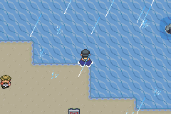
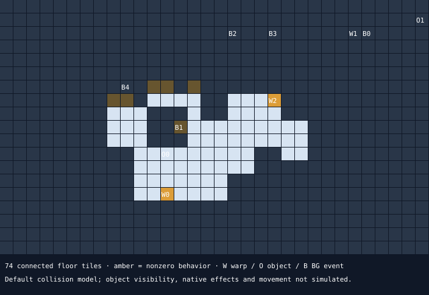
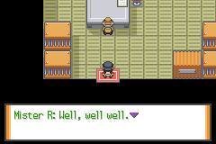

# Mister R puzzle: combined static and emulator diagnosis

Current correction: the initial boot section below records default BPRE flash emulation. The supplied image actually contains banked-SRAM and embedded-NOR cartridge save code. The corrected adapter loads the source cleanly; the old warning is not a valid corruption diagnosis. Laboratory progression and the linked police/Old Key/warehouse journey now pass, including saving and fresh-process reload. See [linked progression findings](linked_progression_findings.md). The local puzzle/battle gap remains unresolved.

The supplied build strongly suggests an unfinished puzzle/battle in Route 59 room `6:31`. The introduction works and removes Mister R, but the room's reachable interactions provide flavor text and a damaged clue. No supported completion handler was found in the inspected script owners or standard field-move menu. This is a diagnosis of this default room, not certification of the whole beta's final stopping point.

Source LC SHA-256: `c69446ff635eeb69c4285c6b76e99c291fee1dc2e54342040bce37b5cdc7e7cf`. No ROM or source-save bytes were changed. Emulator experiments used disposable copies, with only the 128 KiB flash region of the save; its 16-byte trailer remains preserved in the original.

## What now runs

mGBA 0.10.5 was built as a headless software renderer, using its HLE BIOS and default BPRE override. The supplied ROM boots. The copied save produces **“The save file is corrupted”**, then **“The previous save file will be loaded.”** Continue subsequently shows player A, five badges, 21 Pokédex entries and 8:58 play time. Continuing reaches field map `3:62` at `(32,29)`.

This demonstrates recovery and field loading, not clean loading of the newest save or a successful new save/reload cycle. Generations 36 and 35 both contain the same location bytes, so those bytes alone do not identify which generation was loaded. Save-loader checksum lengths remain an open question; no checksum repair was attempted.



The room tests deliberately bypassed normal story progression: a temporary warp bytecode was placed in the emulator's RAM script context, then normal buttons drove the introduction, walking and interactions. Every walking step was checked against live RAM coordinates. This does not establish that the five-badge save can normally reach Orange Islands.

## Room and introduction

Header `0xC30A20`, layout `0xC30F04`, blocks `0xC30A44`; default size 32×19. The indexed layout agrees. Of 608 cells, 74 have collision zero and elevation 3; all 74 belong to one four-neighbor component from entry `(12,14)`. The other 534 cells have collision 1. This model excludes object collision, layout overrides and native effects; the tested walking paths additionally worked in the emulator.



Frame table `0xC099F2` compares operands `0x5331` and zero, selecting `0xAE8D7A`. The introduction sets `0x5331=1`, displays three messages, moves object 1 from `(12,11)` down twice and then up/right to `(20,10)`, makes it invisible, sets visibility flag `0x5C5` and removes it. Every reconstructed movement endpoint is on default floor. Its complete local bytecode contains no trainer-battle command.

The emulator reproduces the speech, movement and disappearance, and returns field control. The tested recovered save had not already consumed the room introduction. Since entry was forced, the test does not validate normal Orange Islands event ordering or flag prerequisites.



## Reachable interactions and the clue

| Location | Default behavior / owner | Result |
|---|---|---|
| `(13,9)` | Signpost, BG 1 → script `0x96D9E6` | Damaged writing; tested from `(14,9)` |
| `(14,6)` | `0x96` TELEPHONE | “It's a telephone. Better not use it.”; tested |
| `(11,6)`, `(12,6)` | `0x9E` BLINKING_LIGHTS | Ordinary flashing-lights text; tested at first light |
| `(8,7)`, `(9,7)` | `0x95` POWER_PLANT_MACHINE | “What could this machine be? Better not mess around with it!”; tested at first machine |

Native compare predicates and interaction dispatch lead to scripts `0x1A7684`, `0x1A768D` and `0x1A76CC`. These short scripts and the selected dispatch intervals match supplied FireRed. Standard scripts 2/3/6 also decode completely as text, waits and release/return operations. The secondary tileset callback's inspected initialization interval is an unchanged animation initializer. These comparisons support the local interaction reading; they are not an audit of every native callee.

The sign's message at `0x9761E0` reads:

```text
There's text that was once written here...
You try to make out the text.
... i.on...t.il .... re....r..d ..cks
```

“Iron Tail” and “red rocks” are plausible reconstructions, not fully surviving instructions. The hint was investigated before diagnosing an unfinished puzzle:

- Standard party field-move list `0x45A76E` and its native selector `0x1229FC–0x122B20` match FireRed. The list contains Flash, Cut, Fly, Strength, Surf, Rock Smash, Waterfall, Teleport, Dig, Milk Drink, Soft-Boiled and Sweet Scent, followed by sentinel 12. It does not offer Iron Tail (move 231).
- The only raw `checkpartymove 231` shape (`7C E7 00`) in this ROM is at `0xD13DA6`, inside a validated pointer-backed LZ77 stream, with no candidate map-owner witness. It is not promoted to a surviving script.
- No coordinate events exist in this room. Its map-owned sign script displays the clue and ends; it does not check a move or write completion state.

A separate custom native action could escape this search. No Iron Tail action or puzzle completion has been demonstrated in the emulator.

## Exits and inherited data

| Warp | Position | Encoded destination | Assessment |
|---|---|---|---|
| 0 | `(12,14)` | Route 59 `3:110`, warp 0 | Default entry/return; indexed return validates |
| 1 | `(26,2)` | Older Goldenrod department store `2:40`, warp 0 | Collision 1, behavior zero, outside the default floor component |
| 2 | `(20,7)` | `0:0`, warp 0 | Directional stair; stepping onto it then pressing east reaches `0:0` in the forced test |

The first east press only placed the player at `(20,7)`. The second activated the stair, landing at `(6,8)` in map `0:0`. This directly validates that tested transition; it does not identify a new Orange continuation. The target's later return behavior still depends on state.

The shopping sign at `(27,2)`, vending machines at `(17,2)` / `(20,2)`, Lucky Channel object at `(31,1)`, and ROM-start BG script at `(9,6)` are not adjacent to the default floor component. Object 1's interaction field is also `0x08000000`, a ROM-start pointer rather than null; its functioning introduction comes from the map frame table. Preserve these fields until a reviewed patch specifies their treatment.

## Wider search and its limits

The reproducible search traces **4,037 unique candidate owner roots**, yielding 53,114 unique instruction candidates under 256-instruction / 1,024-state / depth-8 limits. Owners come from the previous physical-prefix map scan with successful full-header parsing. Overlapping table tails remain candidate associations, not certified map counts. Unsupported opcodes, instruction limits and other frontiers are retained and counted in the JSON.

All 69 raw halfword occurrences of `0x5331` and 46 of `0x5C5` remain visible. Supported command witnesses are the introduction's `setvar` at `0xAE8D7A` and `setflag` at `0xAE8DB5`. The candidate condition-owner scan finds the room's one frame-table condition; the visibility-owner scan finds its object 1. Two other state command shapes are in compressed streams; four remain unresolved raw contexts (`0x52AFF4`, `0x553EC9`, `0x611485`, `0x70EFA3`). Raw matches do not establish script alignment. Computed IDs, unindexed scripts and native logic remain outside this negative evidence.

Case-insensitive encoded search retains all 21 “Mister R” and seven “puzzle” hits, including hits without a complete referenced boundary. Twenty-one referenced complete blocks are recovered across the terms. Supported owner witnesses distinguish other Mister R scenes: Mandarin `3:109`, Route 59 context `6:27`, older Mt Silver maps `4:96` / `4:97`, Zane meeting `3:77` and meeting `2:117`. Other puzzle references belong to unrelated rooms, displays or trainer text. They are not evidence that this room's promised battle survives.

## Reproduce and next milestone

```sh
python3 tools/mister_r_audit.py
python3 tools/setup_runtime.py
python3 tools/runtime_smoke.py --frontend /workspace/.cache/liquid-crystal-runtime/mgba-probe --room-interactions
python3 -m unittest discover -s tests -p 'test_*.py' -v
python3 tools/verify_sources.py
```

Static evidence is in `extracted/maps/mister_r_diagnosis.json`; the collision overlay is SVG. Runtime screenshots and the exact button/RAM transcript are in `extracted/runtime/`. The optional emulator builder pins mGBA 0.10.5 and verifies its downloaded archive SHA-256. Python's standard library remains sufficient for static analysis. Build caches live outside the checkout.

Eight new regression tests cover collision/elevation separation, script widths, supplied attribute words, movement, trigger accessibility, native-dispatch tampering and raw-state classification. All 96 project tests pass. The runtime replay passes independently. Source hashes remain unchanged.

The next substantial milestone is a **progression and patch-design decision**, combining this room diagnosis with the unresolved Science Complex/Nexus state and map-variant selection. Use runtime fixtures to test those existing gates, identify the last supported Orange progression boundary, and write a concrete continuation/patch architecture for review. Do not spend another iteration merely re-inventorying this room or claim that a playable continuation exists.

Publish this combined diagnostic/runtime checkpoint now. It adds the first actual ROM boot and recovered-save gameplay evidence. Publication is a milestone action, not necessary after each small change; local saving, environment publication and a GitHub push are separate. No commit or push was performed here.

Later evidence update: the complete controlled first-entry Undersea Express/Kyogre/engine quest now reaches Valencia. The four raw state shapes listed as unresolved above are classified by `mister_r_state_review.py`: three inherited pointer-backed audio-format spans and a validated LZ77 stream, all identical to FireRed. The native trainer audit separately identifies existing Elite battles and Mister G but no recovered named future Mister R team in scope. The historical extraction/search bounds above remain unchanged; these are separate derived reviews.
