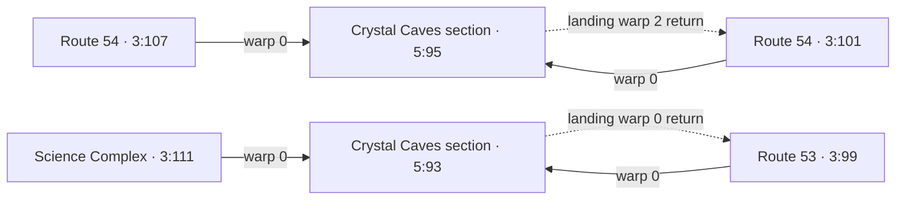

# Controller-map static connectivity

Source SHA-256: `c69446ff635eeb69c4285c6b76e99c291fee1dc2e54342040bce37b5cdc7e7cf`.

One hop from ten controller-owner maps. Target outbound records are retained only as landing/return evidence, not recursively added to the graph. Physical pointer prefixes are inspection bounds, not native counts. Script transitions, collision, metatiles, flags, native hooks and saved dynamic state are not resolved; all gameplay reachability remains UNKNOWN.

CONFIRMED_IN_ROM: raw bytes and pointer chains. STRONGLY_INFERRED: field meanings and dynamic/connection behavior from pinned FireRed references. LC runtime semantics have not been fully compared or tested.

## Verified structure

All 58 source warp records resolve to in-range target warp records; all source and landing coordinates fit their layouts. All 13 connection targets resolve. The 32 distinct map slots retain every alias. For all 32, the header layout pointer matches the independently discovered active layout-ID table.

Native layout lookup at `0x55170` uses literal `0x55194` → `0xC2FC30` and indexes `layoutId - 1`. The layout table is sparse; zero slots do not terminate it. Each selected slot is independently checked. Saved/script layout overrides remain untested. Group/bank physical prefix limits are recorded in JSON; no engine bounds check is asserted.

| Immediate target-warp return relation | Source edges |
|---|---|
| another_map | 20 |
| dynamic_return | 11 |
| exact_return | 26 |
| source_map_different_warp | 1 |

These relations inspect the target warp record only. Exact reciprocity is not a playability test; many valid doors return through a neighboring tile, and dynamic returns depend on saved state.

## Cases requiring further archaeology

- Eleven West Vale Port `5:86` warps target `0:0`, warp 0. That is an ordinary static encoded destination, not a reserved zero tuple. Its landing record at `0x722A84` encodes `127:127:127`; the reference engine treats mapNum 127 as a saved dynamic return. Do not classify these as broken or unused.
- Eleven other `5:86` warps target `1:99` (LIGHTHOUSE). Five landing warps point within `1:99`; six point to `0:0`. Other internal `5:86` links also land on warps targeting `0:0`. Preserve this mixed legacy/internal topology pending metatile and script checks.
- Route 54 slots `3:101` and `3:107` have distinct, byte-identical warp arrays and share a connection array, yet remain different map IDs. Both `3:107` warps return to `3:101`; its two connection targets also refer to the `3:101` topology.
- Science Complex `3:111` warp 0 targets `5:93` warp 0, whose encoded return is Route 53 `3:99`, warp 0. Its east connection to `3:110` has no opposite return in that target array.
- Sandway Town north connection targets `3:60`, header `0x350CA8`, with a null event pointer at `0x350CAC`. Layout and connection bytes parse; no empty-map runtime safety claim follows. Its target connection array includes CONNECTION_NONE (0) at `0x352E5C`, not a cardinal transition.
- Route 54 `3:101` has a west self-connection with displacement 28. Sandway east → Route 56 and the alias/Science Complex links lack inverse records. One-way geometry is not itself an engine error.

Selected outbound links (solid) and target-warp return evidence (dashed); arrows show encoded records, not tested journeys:

## Source connection evidence

| Source | Record | Direction / offset | Target | Inverse return record | Geometric overlap tiles |
|---|---|---|---|---|---|
| 3:99 | 0x72192C | north / 0 | 3:98 | 0x7471CC | 42 |
| 3:99 | 0x721938 | east / 18 | 3:100 | 0x7480D4 | 30 |
| 3:100 | 0x7480D4 | west / -18 | 3:99 | 0x721938 | 30 |
| 3:100 | 0x7480E0 | north / 8 | 3:60 | none | 30 |
| 3:100 | 0x7480EC | east / 0 | 3:104 | none | 36 |
| 3:101 | 0x7413BC | west / 28 | 3:101 | none | 14 |
| 3:101 | 0x7413C8 | north / 2 | 3:102 | 0x741440 | 42 |
| 3:102 | 0x741440 | south / -2 | 3:101 | 0x7413C8 | 42 |
| 3:102 | 0x74144C | west / 0 | 3:103 | 0xC00418 | 35 |
| 3:104 | 0xC01964 | east / 0 | 3:106 | 0xC02AC4 | 36 |
| 3:107 | 0x7413BC | west / 28 | 3:101 | none | 14 |
| 3:107 | 0x7413C8 | north / 2 | 3:102 | none | 42 |
| 3:111 | 0xC052F0 | east / 14 | 3:110 | none | 34 |

Seven source connection records have opposite-direction returns with inverse displacement; six do not. All 13 cardinal connections have nonempty geometric overlap. Collision, actual border crossing, event activation, script warps, native hooks and entry conditions remain untested.

Machine-readable evidence: `extracted/maps/controller_connectivity.json`, `.csv` (71 individual edges), and `.dot` (aggregate display only). JSON retains raw offsets/bytes, target landing records, active-layout checks, null events and unknown directions. See `research/warp_semantics_notes.md` and `research/warp_destination_review.md` for independent interpretation/review.

Next bounded step: enumerate object, coordinate, BG and map-entry scripts for the expanded Orange candidate maps, then identify script-driven transitions and gates around these asymmetric links. No content is certified unused or runtime-unreachable.
