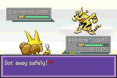
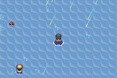

# Orange progression: controlled runtime findings

The existing Route 54 cutscene, charging gate, controller rejection and Nexus shutdown boundary all execute in the supplied build. Two discrepancies now have direct runtime evidence: escaping the intruder battle counts as controller success without exhausting charge, and the default map labelled Science Complex has ocean at its copied cave-warp coordinate. Neither discrepancy alone establishes the whole beta's final progression boundary.

All tests use disposable ROM/save copies and explicitly initialized emulator RAM. The five-badge source save now loads cleanly with the image-specific cartridge adapter; earlier default-flash corruption warnings are superseded as diagnoses. Map entry, flags and counters are forced; the first party member's cached speed is set to 999 for the escape tests. No ROM patch, source-save change, victory test, ten-controller playthrough, fresh save/reload or hardware test is claimed.

## Observed results

| Experiment | Result |
|---|---|
| Route 54 `3:101`, state `0x5305=0`, flag `0x52E=0`, entry warp 0 | Mateo/Marrisa scene completes; state becomes 1, visibility flag becomes 1, control returns |
| Route 54 variant `3:107`, same fixture | Same gate completes; map ID remains 107 and live header matches its own default |
| `3:107` → cave `5:95` → exit | Normal button movement enters the cave; its exit returns to original Route 54 `3:101` |
| Route 53 `3:99` and Science Complex `3:111` forced entries | Both keep their IDs; live headers match the corresponding ROM headers, with no automatic substitution in these states |
| Science Complex `(33,18)` copied warp | Tile behavior is ocean water `0x15`; moving north from `(33,19)` stays on `3:111` |
| Cave `5:93` forced entry, ordinary exit | Returns to Route 53 `3:99`; this cave entry is independently forced, not credited as an exit from Science Complex |
| Charging branch, unavailable flag `0x544=1` | Displays charge success and clears `0x544` |
| Charging branch, `0x544=0` | Displays already-charged text; flag stays clear |
| Actual controller BG at `(16,4)` in `6:23`, unavailable charge | Displays rejection; counter stays 11, controller flag `0x54B` stays clear |
| Controller root `0xAD344E`, available charge; escape Electabuzz battle | Counter 11→10, `0x54B=1`, `0x544=0`, shutdown flag `0x514=0` |
| Repeat used controller | Counter stays 10 |
| Different controller root `0xAD354B` without recharge | Reaches the same intruder-warning branch; stopped by restoring the baseline state before another battle |
| Artificial final-controller fixture, counter 2; escape battle | Counter 2→1, shutdown flag `0x514=1`, `0x175A=0`, control returns; charge remains available |

The battle tests use actual menu inputs and show **“Got away safely!”**. No battle outcome or enemy HP is injected. Script roots are invoked directly for the charged, repeated and final-boundary cases; only the uncharged case additionally validates the placed BG interaction. Counter initialization to 2 tests the completion boundary, not nine preceding victories.



## Why Science Complex is not a ready replacement destination

The default `3:111` layout is 42×48. Of 2,016 cells, **1,989 are ocean-water behavior `0x15` and 27 have behavior zero**. At the copied Route 53 cave coordinate `(33,18)`, the default block is `0x112B`, collision zero, elevation 1, behavior `0x15`. The original Route 53 coordinate instead uses block `0x30A9`, behavior `0x60` (door).

The runtime uses the expected default layout at `0xC323B4`; the live map-header bytes match header `0xC313D0`. Thus this observation is not merely a mistaken text label or the original map being silently loaded. The source save's Surf state persists through forced entry, which explains the player's ability to move over the ocean fixture. Other story states, saved layout overrides or indirect selectors remain unaudited.



Redirecting Route 53 or its cave return to `3:111` would therefore not repair a demonstrated progression link. Preserve both IDs. The Route 54 variant's ordinary cave return likewise favors retaining the original topology; the tested cutscene already works on `3:101`.

## State access and provenance

The LC `GetVarPointer` hook at `0x6E468` targets Thumb address `0x087BAD79`. The inspected hook accepts extended variables `0x5000–0x5562`, using fixed RAM base `0x0203D400`. Runtime roundtrips verify `setvar 0x5318,11`, flag set and flag clear before the experiments. This finding does not certify unused variables. The separate linked replay verifies save persistence of existing variable 0x5331, rather than the entire range.

The live map-header RAM address `0x02036DFC` is corroborated by literal `0x552B4` and the header-copy routine. Player party address `0x02024284` is corroborated by literal `0x40C7C` and the native party-count routine. The retained Pokémon structure places cached speed at offset `0x5E`. Native byte evidence is retained in the result JSON. No assumption that LC shares every FireRed address is needed.

The fixture runner rejects script calls in its RAM context storage, checks native identities before reading state, checks expected map locations, bounds waits and records failure states. Original hashes are checked after execution even on failure. Temporary emulator states and copied saves are deleted after closing the frontend.

## Reproduce

```sh
python3 tools/setup_runtime.py
python3 tools/progression_runtime.py
python3 -m unittest discover -s tests -p 'test_*.py' -v
python3 tools/verify_sources.py
```

The completed replay has 31 passing runtime expectations and a 771-command transcript under `extracted/runtime/progression/progression.json`, with screenshots beside it. All 104 project tests pass, including eight new fixture/evidence regressions. Source hashes are unchanged. Result timestamps are UTC provenance, not a user-facing schedule.

The first fixture attempt entered Nexus Laboratory `5:102` with its introductory state `0x5315=0` and did not regain control within the bound; this was not diagnosed as a game defect. The final controller fixtures use its independently placed copy in `6:23`, which has no map-entry script. That avoids conflating an unrelated laboratory introduction with controller behavior.

Next: use these constraints and the Mister R diagnosis to finish the progression-boundary argument and continuation specification. Do not fix the controller discrepancy or reroute maps as incidental changes to a continuation patch.

The 31 expectations were rerun successfully using the banked-SRAM plus embedded-NOR adapter. See linked_progression_findings.md for the additional 21-check journey, laboratory battle and fresh-process persistence test. The absence of a save/reload test above describes this particular experiment, not the current project as a whole.
