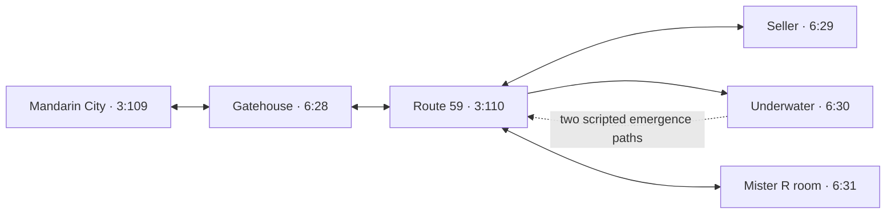

# Route 59 destination and progression audit

Source SHA-256: `c69446ff635eeb69c4285c6b76e99c291fee1dc2e54342040bce37b5cdc7e7cf`.

Route 59 plus its four direct destination maps supply static edges. Other map slots are landing/return context only; their outgoing graphs/scripts are not recursively expanded. Default layout validation does not resolve collision, movement, saved flags, map-entry activation or native effects. All gameplay reachability remains UNKNOWN.

CONFIRMED_IN_ROM: bytes, pointers, structural links and source ownership. STRONGLY_INFERRED: FireRed script/event/native meanings. No authored story or ROM/save changes.

```json
{
  "new_destination_maps": 4,
  "graph_context_maps": 13,
  "catalogued_event_records": 29,
  "script_associations": 29,
  "unique_script_roots": 15,
  "static_warp_edges": 19,
  "static_connection_edges": 1,
  "warp_return_relations": {
    "another_map": 8,
    "dynamic_return": 1,
    "exact_return": 9,
    "source_map_different_warp": 1
  },
  "ROM_start_script_fields": 4,
  "scripted_transition_instructions": 2,
  "scripted_transition_owner_associations": 12
}
```

## Four destination maps

| Map | Header | Default size | Objects / warps / coordinates / BG | Evidence-based role |
|---|---|---|---|---|
| 6:28 | 0xC167FC | 15×12 | 3 / 2 / 0 / 0 | Gatehouse between Mandarin City and Route 59 |
| 6:29 | 0xC16F70 | 13×10 | 2 / 1 / 0 / 0 | Black Flute seller house |
| 6:30 | 0xC398CC | 55×40 | 2 / 8 / 1 / 14 | Underwater passages with emergence scripts |
| 6:31 | 0xC30A20 | 32×19 | 2 / 3 / 0 / 5 | Mister R introduction/puzzle room; completion unresolved |

All four share the ROUTE 59 section label; it is not a unique building name. All inspected default layouts match their native layout-ID slots. The graph retains legacy/dynamic targets separately.



Arrows summarize encoded links only. The underwater map also has legacy exits; the diagram omits those to keep the progression lead readable.

## New map-owned progression evidence

- Gatehouse `6:28` warp 0 returns to Mandarin City `3:109` warp 2; warp 1 leads to Route 59 `3:110` warp 3. Both have exact encoded return records. NPC dialogue identifies the Science Complex beyond Route 59 and warns that the area is dangerous.
- Seller `6:29` root `0xA9C566` checks flag `0x5C0`, displays an offer for a Black Flute, checks/removes 50,000 money (`0xC350`), supplies item tuple `0x2A × 1` through callstd 0, and sets flag `0x5C0` on the candidate success branch. The trace retains decline, insufficient-money and inventory-failure branches. Native/standard transaction execution is untested.
- Underwater `6:30` has two distinct emergence roots, `0xAA087D` and `0xAE8C6D`, each owned by six BG records. Both check move operand `0x123`, branch on flag `0x1685` and a prompt result, run field effect `0x25`, wait, then use warpteleport. The commands at `0xAA08C1` / `0xAE8CB1` target Route 59 warps 1 / 4 respectively. Both indexed landings validate. Script conditions, the field effect and wait/resume remain assumptions.
- Room `6:31` map table `0xC0AA14` (tag 2) points to condition table `0xC099F2`: VarGet(`0x5331`) == VarGet(0) selects `0xAE8D7A`. The intro sets operand `0x5331` to 1, shows Mister R dialogue, moves local object 1, then sets its visibility flag `0x5C5` at `0xAE8DB5` and removes it at `0xAE8DB8`. The complete local format trace contains no trainer-battle command. A promised battle in dialogue is not proof that a completion/battle script survives.

## Mister R introduction text

`0xAE8FA4`

```text
<COLOR 08>Mister R: Well, well well.<PARAGRAPH>

What have we here..?
```

`0xAE8F1B`

```text
<COLOR 08>I must say, I’m ever so slightly
amused you were able to enter here.<PARAGRAPH>

However, I regret to inform you that
this is as far as you go.
```

`0xAE8DD0`

```text
<COLOR 08>You see, the rest of the way is a
dead end... becuase I blocked it off.<PARAGRAPH>

Oh? What was that?<PARAGRAPH>

You think you can beat me in a 1-on-1
battle?!<PARAGRAPH>

HAHAHA!<PARAGRAPH>

Hahaha... ha...<PARAGRAPH>

You seem overly confident, and
delusional to boot...<PARAGRAPH>

Well, this could be quite amusing.<PARAGRAPH>

If you are able to solve my puzzle,
I will challenge you to a battle.<PARAGRAPH>

Ciao!
```

## Structural concerns retained

- Four interaction fields contain `0x08000000`, not null `0x00000000`: one object in `6:29`, one in `6:30`, and object 1 plus BG record 4 in `6:31`. They target ROM offset zero (reset-vector data), where this decoder stops at unsupported opcode FE. They remain explicit unresolved script candidates; they are not normalized into valid empty scripts.
- Underwater warp 1 returns to Route 59 warp 2, whose outgoing record enters seller map `6:29`. Its BG emergence scripts instead target Route 59 warps 1/4. Six other underwater warp records point into older DARK CAVE, UNDERSEA CAVERN and ROUTE 34 map slots; their indexed landings validate but returns do not lead to `6:30`. Metatiles/activation must be checked before diagnosing or changing these rows.
- Mister R room warp 1 targets `2:40` (GOLDENROD DEPT. section), whose landing row returns within the older department-store topology. The room retains a 6F shopping sign, Lucky Channel NPC and vending-machine scripts. Warp 2 targets `0:0` with a dynamically encoded return, which remains a supported special pattern rather than an invalid zero tuple.
- Two hidden-item BG unions are exported as data, not script pointers. The coordinate event in `6:30` checks operand `0x4050` against zero and uses specials `0x114` / `0x113`; load script `0x974239` sets operands `0x4060/61/62` to `1/9/12`. Their native effects and current state are unresolved.

## Trace and native comparison limits

```json
{
  "focus_roots": 15,
  "unique_instruction_candidates": 267,
  "transition_or_destination_setter_instructions": 2,
  "layout_setter_instructions": 0,
  "unique_strict_complete_messages": 28,
  "instruction_overlap_records": 0,
  "frontier_reasons": {
    "unsupported opcode FE": 1
  }
}
```

New UI/money/buffer command widths use pinned asm/macros/event.inc. The retained native handler-interval probe compares used new commands plus warpteleport, field-effect, special and wait handlers against supplied FireRed; helper code, runtime conditions, task effects and map collision are not emulated. All format edges retain assumptions around UI, standard/native calls, field effects and warp resumes.

Next bounded step: audit Mister R room metatiles, movement data and interaction triggers, then search for a puzzle-completion/battle path tied to operand `0x5331` and flag `0x5C5`. Keep this separate from certifying the public beta dead end.

Evidence files: `extracted/maps/route59_destination_audit.json`, `route59_links.csv`, and `extracted/scripts/route59_script_associations.csv`. This is a useful publication checkpoint: it adds a map-owned progression lead with tested extraction; no ROM/save changes or playable continuation are produced.
